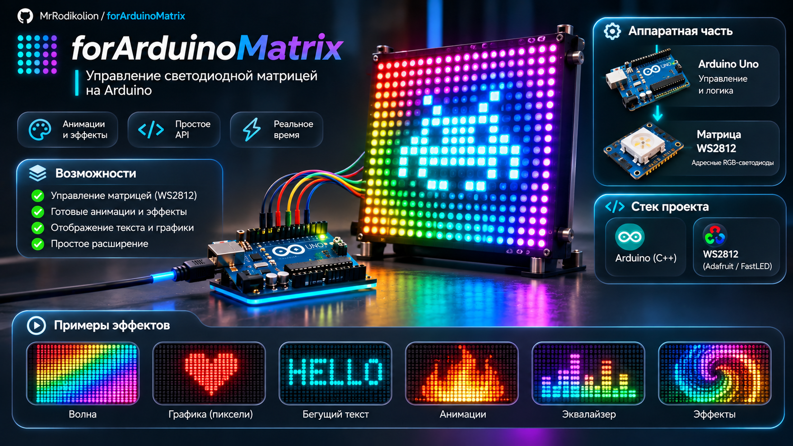
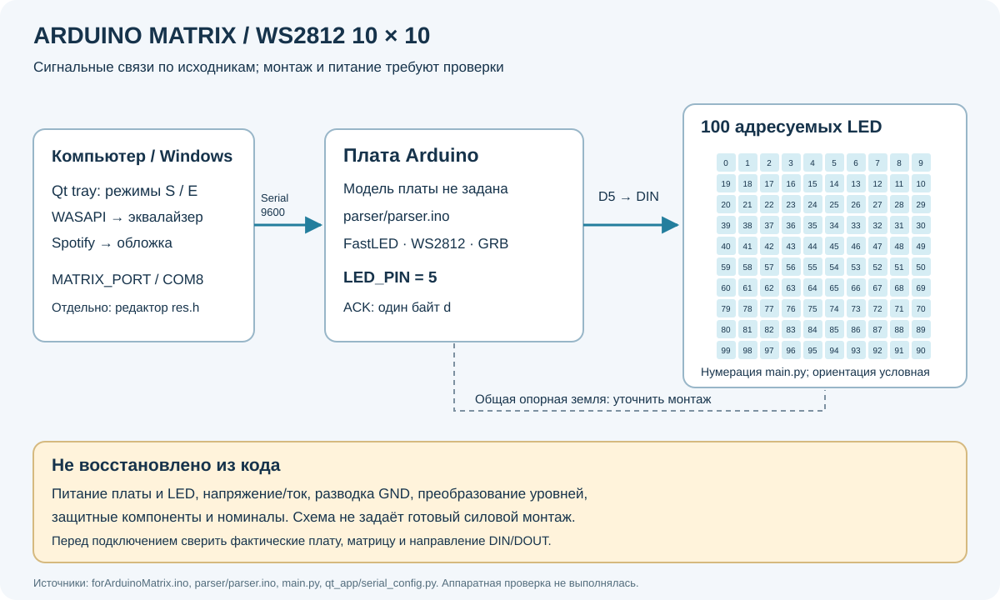

# Arduino Matrix · WS2812 10×10



*Концептуальная иллюстрация: изображение не является точной схемой или подтверждением аппаратной реализации.*

**Рисование на LED-матрице, аудиоэквалайзер и обложка Spotify.**

Проект объединяет редактор 100 пикселей, несколько Arduino sketches и Windows
tray-приложение. В режиме эквалайзера системный звук превращается в десять
столбцов; Spotify-режим передаёт обложку и меняет яркость по звуку.

[Схема устройства](#схема-устройства) · [Режимы](#режимы-и-совместимость) · [Запуск](#запуск) · [Протокол](#протокол-основного-контроллера) · [Проверки](#проверки-и-ограничения)

## Схема устройства



По исходникам подтверждены **100 LED**, сетка **10×10**, библиотека **FastLED**,
вывод данных **D5**, тип **WS2812**, порядок каналов **GRB** и Serial **9600 бод**.
Змейка на схеме соответствует нумерации редактора `main.py`: первая строка
0…9, вторая 19…10 и далее. Реальная ориентация матрицы должна совпадать с монтажом.

Схема не заменяет электрический чертёж. Модель Arduino, питание/допустимый ток,
уровни сигналов, защитные компоненты и номиналы в коде не указаны. Общая опорная
земля показана как требование согласования сигнала; фактическая разводка не
восстановлена. До подключения сверяйте конкретные плату и матрицу.

## Режимы и совместимость

| Режим | Компьютер | Arduino sketch | Назначение |
|---|---|---|---|
| Автономный рисунок | `main.py` + pygame | `forArduinoMatrix.ino` + `res.h` | Редактор сохраняет массив цветов; sketch показывает его без serial |
| Windows tray | `qt_app/app.py` | **`parser/parser.ino`** | Переключение Spotify/Equalizer/Pause/Quit, общий протокол S/E |
| Старое serial-рисование | `with_serial/sender.py` | `with_serial/with_serial.ino` | Исторический протокол `$...;` |
| Старый Spotify-вариант | `spotify/` | `spotify/spotify.ino` | Исторический отдельный эксперимент |
| Старый аудиовариант | `with_serial/audio/` | `with_serial/audio/audio.ino` | Отдельный аудиопротокол `$...;` |

Эти sketches — **альтернативы**, а не прошивки, которые нужно загружать вместе.
Qt tray использует только S/E-протокол `parser/parser.ino`. Старые отправители
и sketches сохранены, но не объявляются взаимозаменяемыми или проверенными.

## Запуск

### Редактор рисунка без оборудования

Нужны Python и pygame. Из корня репозитория:

```powershell
python -m venv venv
.\venv\Scripts\python.exe -m pip install pygame
.\venv\Scripts\python.exe main.py
```

Выберите цвет внизу окна и рисуйте мышью по сетке. При закрытии редактор
перезаписывает `res.h` в текущем каталоге; сохраняйте нужный рисунок отдельно.
Затем для автономной матрицы используется корневой `forArduinoMatrix.ino`.

### Windows tray и оборудование

Этот вариант требует Windows, WASAPI loopback, доступного serial-порта и
соответствующей прошивки. На Windows устанавливаются существующие зависимости:

```powershell
.\venv\Scripts\python.exe -m pip install PyQt5 pyaudiowpatch numpy pyserial spotipy Pillow requests pywin32 psutil PyGetWindow
$env:MATRIX_PORT = 'COM8'
.\venv\Scripts\python.exe qt_app/app.py
```

Без `MATRIX_PORT` используется исторический **COM8**. Приложение начинает с
**Equalizer Mode**; закрывать его нужно через **Quit** в меню значка системного
трея. **Pause** останавливает текущий режим. Повторный выбор активного режима
не создаёт новый поток. При незавершённой остановке приложение отказывается
переключать режим, чтобы два владельца не открыли один порт.

Spotify-режиму дополнительно нужны работающий desktop Spotify, сетевой доступ
и совместимая OAuth-конфигурация. Существующая конфигурация учётных данных в
этом проходе не менялась и не проверялась. Отсутствие окна Spotify обрабатывается
без обращения к несуществующему элементу списка.

### Прошивка

1. Уточните модель платы, электрическое подключение и направление DIN матрицы.
2. Установите FastLED в Arduino IDE и выберите **реальную** плату и порт.
3. Для tray-приложения откройте `parser/parser.ino`; для автономного рисунка —
   `forArduinoMatrix.ino` вместе с корневым `res.h`.
4. Соберите код до загрузки. Аппаратная загрузка в ходе этой доработки не выполнялась.

В репозитории нет PlatformIO manifest. Проверка компиляции для отдельной
выбранной build-платы не подтверждает, что именно она установлена у пользователя.

## Протокол основного контроллера

Serial **9600 бод**, ASCII-числа; каждая команда заканчивается запятой.

| Команда | Поля | Допустимые значения | Пример |
|---|---|---|---|
| `S` | LED, R, G, B, brightness | LED 0…99; остальные 0…255 | `S0,255,0,0,20,` |
| `E` | Десять высот столбцов | Каждая 0…10 | `E0,1,2,3,4,5,6,7,8,10,` |

После корректной команды Arduino отправляет один байт **`d`**. Неверный пакет
не применяется и не подтверждается. Частичный пакет сбрасывается после паузы
**больше 1 секунды** без новых байтов;
новый `S`/`E` начинает новый пакет. Команда и ожидание ACK в Python выполняются
под общей блокировкой, чтобы потоки аудио и обложки не смешивали данные.

Таймаут чтения/записи serial — **1 секунда**. Отсутствие ожидаемого `d` считается
ошибкой, а не успешной передачей. Это подтверждение принятия команды прошивкой,
а не измерение фактического света или исправности питания.

## Компоненты

| Путь | Назначение |
|---|---|
| [main.py](main.py), [collor.py](collor.py) | Редактор цвета/сетки и экспорт `res.h` |
| [forArduinoMatrix.ino](forArduinoMatrix.ino) | Автономное отображение сохранённого рисунка |
| [parser/parser.ino](parser/parser.ino) | Общий S/E-парсер и вывод на матрицу |
| [qt_app/app.py](qt_app/app.py) | Tray-меню и жизненный цикл режимов |
| [qt_app/serial_config.py](qt_app/serial_config.py) | Настройки порта и атомарный command/ACK |
| [qt_app/Equalizer.py](qt_app/Equalizer.py) | WASAPI/FFT и десять столбцов |
| [qt_app/spotify.py](qt_app/spotify.py) | Окно Spotify, обложка и аудиореактивная яркость |

## Проверки и ограничения

При доработке 8 ноября 2026 года выполнены проверки отдельно от устройств:

- **13/13 Python-проверок PASS** на Python 3.11.7: тишина, serial/ACK,
  переключение и остановка потоков, отсутствие окна Spotify, закрытие порта при
  сбоях и запуск настоящего Qt entry point в offscreen-режиме с fake workers.
- **5/5 native C++ проверок PASS** на настоящих sketches с MockSerial/FastLED.
  Каждый из четырёх UART-sketches дополнительно принял по **100 000 случайных
  байтов** под UndefinedBehaviorSanitizer; проверены фрагментация, неверные поля,
  границы и восстановление приёма. Пятый sketch проверен на инициализацию.
- **5/5 AVR-сборок PASS** для выбранной тестовой цели Arduino Uno:
  FastLED 3.6.0, atmelavr 5.1.0, framework-arduino-avr 5.2.0. Это проверка
  компиляции; фактическая плата пользователя из исходников не установлена.
- Синтаксис **11 Python-файлов**, `pip check` и `git diff --check` — **PASS**.

Проверочные environments и harness находятся вне репозитория. Внешние регрессии
не используют реальное звуковое устройство, аккаунт Spotify или включённую
матрицу. Постоянного набора тестов в проекте пока нет.

```powershell
.\venv\Scripts\python.exe -m compileall -q main.py collor.py qt_app
.\venv\Scripts\python.exe -m pip check
```

Реальные WASAPI/OAuth/Spotify, электрическое подключение, загрузка прошивки и
работа 100 LED не проверены. Тишина больше не приводит к делению на ноль;
ошибки worker сохраняются в его поле `error`, но полноценного окна диагностики
ещё нет. Старые отдельные `$...;`-sketches остаются экспериментальными и требуют
собственной проверки перед аппаратным запуском.

## Roadmap

- [ ] Зафиксировать фактическую модель платы и электрическую схему питания.
- [ ] Провести стендовые проверки матрицы, ACK/разрывов связи и режимов.
- [ ] Настроить переносимую OAuth-конфигурацию отдельной задачей.
- [ ] Вывести ошибки потоков в понятное окно диагностики.
- [ ] Зафиксировать зависимости и постоянные parser/thread regression tests.
- [ ] Проверить старые sketches и документировать их отдельные протоколы.

Статус — аппаратный прототип; подтверждённый стабильный релиз не объявлен.
